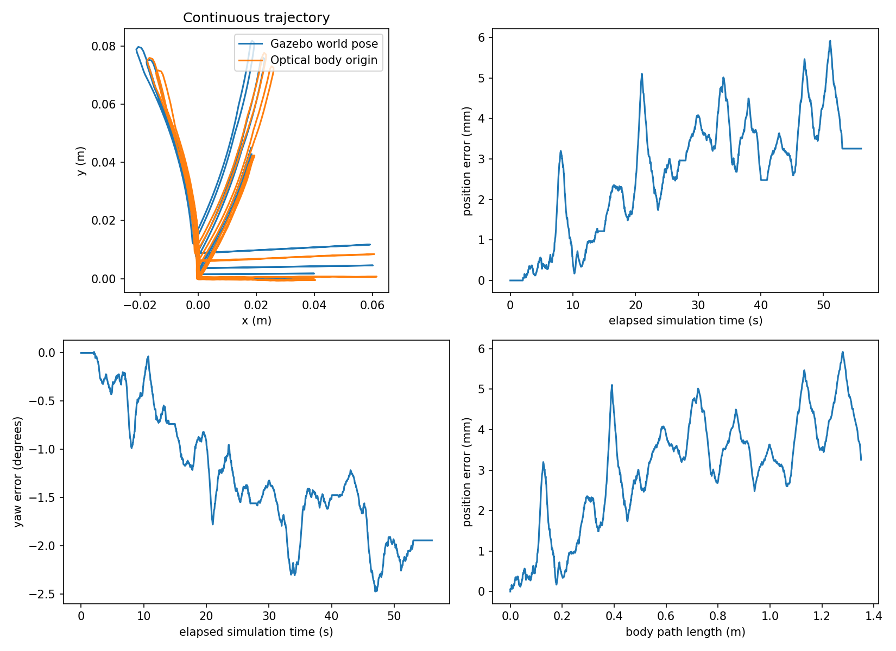

# Optical-Flow Odometry for a Differential-Drive Robot Using ROS2 and Gazebo

University robotics internship project by **Ozodbek Eshmurodov**, supervised by Professor Aleksandr Kapitonov. A downward-facing camera estimates planar robot motion from floor images; estimates are evaluated against independent Gazebo world poses.

The robot simulation is adapted from [Lucas Mazzetto's differential-drive robot](https://github.com/lucasmazzetto/gazebo_differential_drive_robot). See [NOTICE](NOTICE) for upstream history, attribution and modifications. Both packages are included as ordinary directories; no submodule checkout is needed.

## Features

- Downward-facing camera and deterministic textured floor made from local SDF geometry.
- Shi–Tomasi corner detection, pyramidal Lucas–Kanade tracking and RANSAC similarity estimation.
- Calibrated metric displacement, yaw, camera lever-arm compensation and finite SE(2) integration.
- Body-origin or axle-reference odometry, an interval-aware motion protocol and ROS2 tracking diagnostics.
- Synthetic geometry/failure tests and automated validation against **Gazebo world poses**, separately from wheel odometry.

## Requirements

Ubuntu **24.04**, ROS2 **Jazzy**, Gazebo **Harmonic**, Python 3, OpenCV and NumPy. WSL2 was used for development; Gazebo rendering requires working graphics/WSLg or an appropriate Linux graphics environment. Install ROS2 Jazzy using its [official Ubuntu instructions](https://docs.ros.org/en/jazzy/Installation/Ubuntu-Install-Debs.html) first. The Jazzy `ros_gz` integration uses Gazebo Harmonic.

## Install and build

```bash
sudo apt update
sudo apt install -y git python3-colcon-common-extensions python3-rosdep \
  ros-jazzy-ros-gz ros-jazzy-xacro ros-jazzy-robot-state-publisher \
  ros-jazzy-joint-state-publisher ros-jazzy-cv-bridge \
  python3-opencv python3-numpy python3-matplotlib python3-pytest \
  ros-jazzy-ament-lint-auto ros-jazzy-ament-lint-common \
  ros-jazzy-ament-flake8 ros-jazzy-ament-pep257 ros-jazzy-ament-copyright

source /opt/ros/jazzy/setup.bash
git clone https://github.com/Ozodbek-create/ros2-gazebo-optical-flow-odometry.git
cd ros2-gazebo-optical-flow-odometry
# If rosdep has never been initialized on this machine: sudo rosdep init
rosdep update
rosdep install --from-paths src --ignore-src --rosdistro jazzy -r -y
colcon build --symlink-install
source install/setup.bash
```

For the Telegram ZIP, extract its top-level folder and start at `cd ros2-gazebo-optical-flow-odometry`; cloning is unnecessary. Run commands from the repository root. In every additional terminal, source ROS and this repository's `install/setup.bash`.

## Run the simulation

```bash
source /opt/ros/jazzy/setup.bash
source install/setup.bash
ros2 launch gazebo_differential_drive_robot robot.launch.py
```

The installed custom `worlds/optical_flow.sdf` is the default. Its explicit equivalent is:

```bash
ros2 launch gazebo_differential_drive_robot robot.launch.py \
  world:="$(ros2 pkg prefix --share gazebo_differential_drive_robot)/worlds/optical_flow.sdf"
```

For a server-only run, add `gz_args:="-r -s -v 3"`. Headless camera rendering still requires usable rendering support. The world is bundled and needs no network textures. To regenerate it deterministically into a new file:

```bash
python3 src/gazebo_differential_drive_robot/generate_world.py --output /tmp/optical_flow.sdf
```

## Run odometry

In two separate sourced terminals:

```bash
ros2 run optical_flow_odometry optical_flow_node
```

```bash
ros2 run optical_flow_odometry metric_odometry_node
```

The physical simulated camera offset is **camera_x=-0.15 m relative to body_link**; keep it. The camera is above the drive axle. Body-origin displacement during an axle-centered turn is real geometry, not automatically drift. For axle-reference estimates use:

```bash
ros2 run optical_flow_odometry metric_odometry_node --ros-args \
  -p reference_x:=-0.15 -p reference_frame:=drive_axle
```

Run only one metric node per output topic. No TF is published by optical odometry. Gazebo's DiffDrive `/odom` has a body_link label but represents axle kinematics in this model; it is not independent world-position truth.

## ROS2 interfaces

| Topic | Type | Meaning |
|---|---|---|
| `/camera/down/image_raw` | `sensor_msgs/Image` | 320×240 downward simulated images; sensor-data QoS |
| `/camera/down/camera_info` | `sensor_msgs/CameraInfo` | Matching simulated intrinsics |
| `/optical_flow/measurement` | `std_msgs/String` | Atomic version-1 JSON: image interval, pixel motion, yaw, quality and validity |
| `/optical_flow/image_motion` | `geometry_msgs/Vector3Stamped` | Legacy valid-only pixel/radian increments |
| `/optical_flow/delta_body` | `geometry_msgs/Vector3Stamped` | Finite metric displacement in previous reference axes and yaw increment |
| `/optical_flow/odom` | `nav_msgs/Odometry` | Integrated pose and interval-average twist |
| `/diagnostics` | `diagnostic_msgs/DiagnosticArray` | Tracking metrics, rejection reasons, stale-input and incomplete-pose status |
| `/odom` | `nav_msgs/Odometry` | Gazebo wheel-derived odometry, a comparison sensor |
| `/cmd_vel` | `geometry_msgs/Twist` | Simulated drive command; has no automatic timeout in DiffDrive |

The default metric input is the interval-aware topic; `legacy_input:=true` is compatibility mode with weaker timing/quality guarantees. Lost displacement latches `pose_incomplete`; track recovery cannot reconstruct it. Quality gates are engineering thresholds, **not calibrated probabilities**. See [ROS_INTERFACE.md](src/optical_flow_odometry/ROS_INTERFACE.md).

## Validation

Historical continuous-trajectory benchmark, independently time-aligned to actual Gazebo body-origin world poses:

| Metric | Result |
|---|---:|
| Duration | 56.033 s |
| Body path | 1.351 m |
| Position ATE RMSE | 3.01 mm |
| Final position error | 3.26 mm |
| Final yaw error | −1.94° |
| Core regression | 37 passed, one existing skip |



These are **simulation results**, not physical TRIK performance or accuracy guarantees. The figure includes trajectory comparison and error growth over time/distance. Compact numeric trajectory/reference summaries are bundled; excessive raw image recordings are excluded. See [validation details](docs/VALIDATION.md) and [distribution verification](docs/REPRODUCIBILITY.md).

```bash
colcon test --packages-select optical_flow_odometry --event-handlers console_direct+
colcon test-result --verbose
python3 -m compileall -q src/optical_flow_odometry/optical_flow_odometry validation
```

For a fresh bounded motion recording, run the simulation and both processing nodes, verify no other `/cmd_vel` publisher, then:

```bash
python3 validation/continuous_capture.py --output validation_output/trial01
python3 validation/evaluate.py --dataset validation_output/trial01/live_capture.npz \
  --output validation_output/trial01_analysis
```

The recorder uses Gazebo Transport 13 / Messages 10 Python modules supplied by the Jazzy Gazebo vendor environment; source ROS first. It refuses existing output recordings, competing ROS command publishers or unsafe camera positions and sends stops in cleanup. It is for this simulated model/world only. The patterned area is approximately 0.96×0.96 m: arbitrary driving can leave it. Do not use unbounded teleoperation or interrupt a command publisher without sending zero velocity.

## Limitations and future work

Residual yaw drift, rendering/feature dependence and accumulated error remain. The algorithm assumes calibrated, rectified images from a level downward camera above locally planar texture. Simulated height is 0.085 m; mounting, intrinsics, distortion and clock alignment must all be measured anew for real hardware. Covariances and quality thresholds are not statistically calibrated. Clock discontinuity/tracking loss can leave pose incomplete. This distribution does not include TRIK preparation experiments, a physical camera driver, or sensor fusion; the full system has **not been tested on a physical TRIK robot**.

## Credits and license

Robot foundation: **Lucas Mazzetto**, with upstream contributions credited in [NOTICE](NOTICE), pinned to upstream commit `3e455f8749ca2f01636366d88d0b385b7823b8b5`. Internship camera/world/odometry/diagnostic/validation additions: **Ozodbek Eshmurodov**. Packaging changes are documented in NOTICE and marked in modified upstream files. OpenCV and ROS/Gazebo are external dependencies, not vendored third-party code. Distributed under **Apache-2.0**, consistent with the upstream manifest and optical-flow package; full license text and attribution are included.
